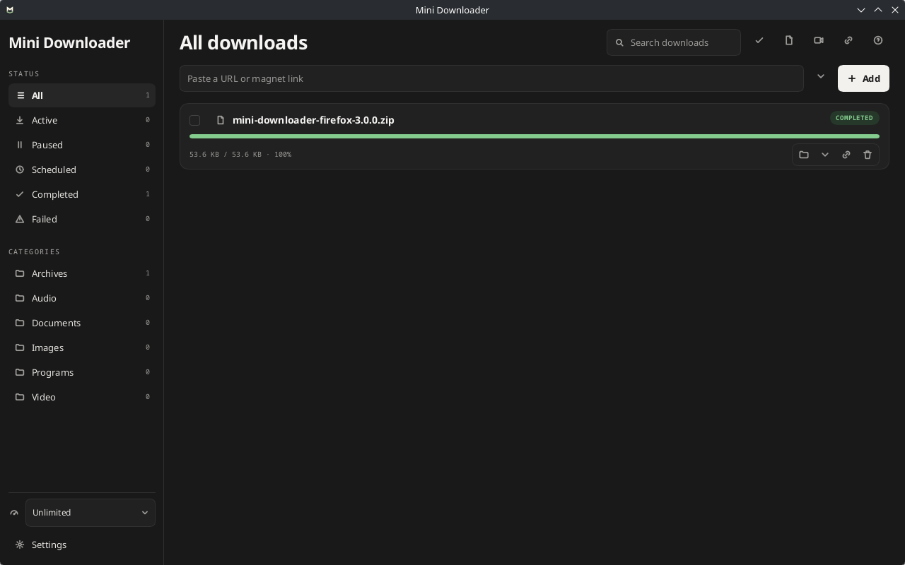
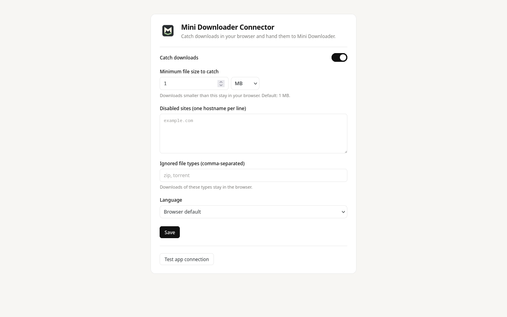

# Mini Downloader


[](https://github.com/RamazanBerk20/mini-downloader/actions/workflows/build.yml)
[](https://github.com/RamazanBerk20/mini-downloader/releases)
[](LICENSE)
[](https://github.com/sponsors/RamazanBerk20)

A lightweight, local-first download manager for Linux and Windows. The desktop
UI is native Rust + Slint and uses the software renderer, so an idle window does
not keep a browser engine, GPU driver stack, or JavaScript runtime resident.



## Install

Download the current package and `SHA256SUMS` from
[GitHub Releases](https://github.com/RamazanBerk20/mini-downloader/releases/latest).
Release files also carry GitHub build-provenance attestations; verify one with
`gh attestation verify <artifact> -R RamazanBerk20/mini-downloader`.

Linux releases include `.deb`, `.rpm`, AppImage, and portable `.tar.gz`
artifacts. Install `aria2` and `xdg-utils`; install `yt-dlp` and `ffmpeg` for
media downloads.
The AppImage intentionally uses these host tools rather than keeping duplicate
copies resident or silently self-updating them.

Until AUR publishing resumes, Arch-based distributions should use the AppImage
or portable `.tar.gz` from GitHub Releases. Maintainer-ready recipes for the
prebuilt, tagged-source, and current-`main` variants remain under
[`packaging/aur`](packaging/aur) for local packaging and future publication.

Windows releases include a per-user NSIS installer and a portable `.zip`.
`aria2c` and `yt-dlp` are bundled; install `ffmpeg` and add it to `PATH` for
video/audio muxing. Signed releases establish the Mini Downloader publisher
identity. Unsigned releases—including v3.0.0—carry an explicit warning in the
release notes and `WINDOWS-UNSIGNED.txt`; Windows may show an Unknown publisher
warning. Always verify `SHA256SUMS` before running a download.

## Features

- Segmented HTTP(S)/FTP downloads, pause/resume, speed limits, SHA-256 checks,
  torrents, magnets, and metalinks through aria2.
- yt-dlp media probing and downloading, playlists, formats, subtitles, audio
  extraction, thumbnails, and HLS/DASH support.
- Bulk link extraction with numeric ranges, packages, categories, automatic
  organization, schedules, notifications, and completion actions.
- Proxy, BitTorrent DHT, optional helper sandboxing, best-effort initial
  local-address blocking,
  clipboard watching, tray, autostart, and URL-scheme integration.
- Keyboard and screen-reader accessibility plus ten interface languages.

## Low-memory lifecycle

One small controller owns durable state, browser IPC, and the tray. The visible
Slint renderer is a disposable `--ui-client` child: closing or hiding it exits
that process and releases all UI memory. aria2 starts only when work requires it
and shuts down after a 30-second idle grace period. The scheduler sleeps until
an actual deadline instead of polling continuously.

The regression budgets are 100 MiB total PSS while visible and 50 MiB while
hidden. Measure the release build in an active desktop session with:

```sh
./scripts/measure-memory.sh both
```

The benchmark uses isolated temporary config/data directories and reports PSS
for the whole controller process tree, not misleading per-process RSS totals.

## Browser connector

The optional connector transmits browser downloads to the local app with the URL,
cookies, referer, and user agent needed for authenticated downloads. It also
captures HLS/DASH page media. In Mozilla's policy terminology this is data
transmission outside the add-on; it stays on the local machine and is disclosed
at Firefox installation.

| Browser family | Store |
| --- | --- |
| Firefox and Firefox-based browsers | [Firefox Add-ons](https://addons.mozilla.org/firefox/addon/mini-downloader-connector/) |
| Chrome, Chromium, Edge, Brave, and compatible browsers | [Chrome Web Store](https://chromewebstore.google.com/detail/mini-downloader-connector/hhaobmkdgijodfieadeeanjmnneckafj) |



The app registers its native-messaging host on first launch. AppImage users get
a private stable host copy, so browser integration survives temporary mount
paths. Browsers still
require their normal user-confirmed extension installation flow. For local
extension development:

```sh
./scripts/build-extension.sh
```

Load `dist-ext/firefox/manifest.json` from Firefox `about:debugging`, or load
`dist-ext/chrome/` as an unpacked Chromium extension.

## Develop

Rust stable and the native window/font development libraries are required.
Node, pnpm, Tauri, WebKitGTK, GTK, and AppIndicator are not part of the desktop
build.

On Arch/CachyOS, review and run:

```sh
./scripts/install-arch.sh
```

On Debian/Ubuntu:

```sh
sudo apt-get update
sudo apt-get install -y \
  build-essential pkg-config libfontconfig1-dev libwayland-dev \
  libxkbcommon-dev libx11-dev libx11-xcb-dev libxcb1-dev \
  libxcursor-dev libxrandr-dev libxi-dev xdg-utils aria2 ffmpeg yt-dlp
```

Build, test, and run:

```sh
cargo test --workspace --locked
cargo run -p minidl-native-desktop
cargo build --release -p minidl-native-desktop -p minidl-native-host
```

Create native Linux artifacts with `./scripts/package-linux.sh`. It always
creates the portable tarball and additionally creates deb/rpm/AppImage packages
when `fpm` and `linuxdeploy` are installed. On Windows, stage `aria2c.exe` and
`yt-dlp.exe` in `dist-native/windows-stage`, install NSIS, then run
`./scripts/package-windows.ps1`.

The Dev Container and `compose.yaml` provide the same Ubuntu 22.04 native build
environment. `docker compose run --rm build` creates the portable Linux archive;
GUI and browser-integration testing must run against the host desktop/session.

## Architecture

```text
Slint UI child (exists only while visible)
       │ versioned private control socket
       ▼
native controller + tray
  ├─ minidl-app: lifecycle, scheduler, OS integration, controller IPC
  ├─ minidl-core: SQLite, aria2 RPC, categories, download/media models
  ├─ aria2c child (lazy; stopped when idle)
  └─ yt-dlp child (only during media operations)

browser extension ─ native messaging ─ minidl-native-host
                                      └─ private local bridge ─ controller
```

## Privacy and license

The connector has no analytics or remote code and sends captures only to the
local application. See [PRIVACY.md](PRIVACY.md). Report ordinary bugs through
[GitHub Issues](https://github.com/RamazanBerk20/mini-downloader/issues), and
report vulnerabilities privately as described in [SECURITY.md](SECURITY.md).
If Mini Downloader is useful to you, you can
[sponsor its development](https://github.com/sponsors/RamazanBerk20).

Mini Downloader is licensed under [GPL-3.0-or-later](LICENSE). aria2 is GPLv2,
yt-dlp is Unlicense, and ffmpeg is LGPL/GPL depending on its build. Shipped
dependency notices and license texts are listed in
[THIRD_PARTY_NOTICES.md](THIRD_PARTY_NOTICES.md) and
`THIRD_PARTY_LICENSES.txt`.
